# FolioMD 사용 설명서

> **FolioMD**는 Markdown(.md) 문서를 쓰고 읽는 Windows용 편집기입니다.
> 왼쪽에 글을 쓰면 오른쪽에 완성된 모양이 바로 나옵니다. 표, 수식, 순서도도 그려 줍니다.

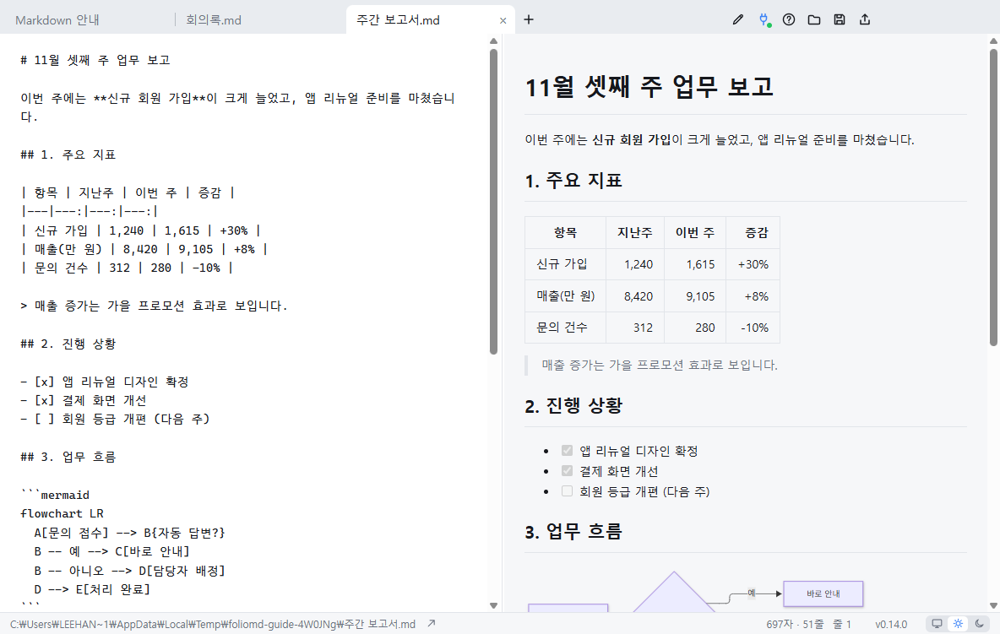

**목차**

1. [설치하기](#1-설치하기)
2. [화면 둘러보기](#2-화면-둘러보기)
3. [문서 열고 저장하기](#3-문서-열고-저장하기)
4. [탭 다루기](#4-탭-다루기)
5. [글 쓰기 (Markdown 기초)](#5-글-쓰기-markdown-기초)
6. [찾기, 바꾸기, 줄 이동](#6-찾기-바꾸기-줄-이동)
7. [미리보기에서 바로 고치기](#7-미리보기에서-바로-고치기)
8. [미리보기에 낙서하기](#8-미리보기에-낙서하기)
9. [PDF, HTML로 내보내기](#9-pdf-html로-내보내기)
10. [업데이트](#10-업데이트)
11. [Claude Code와 함께 쓰기](#11-claude-code와-함께-쓰기)
12. [자주 묻는 질문](#12-자주-묻는-질문)

---

## 1. 설치하기

셋 중 하나를 고르세요. 1분 정도 걸리고, 관리자 권한은 필요 없습니다.

### 방법 1. 한 줄로 설치 (권장)

경고 창 없이 설치됩니다.

1. 키보드에서 **Win + R**을 누릅니다.
2. 아래 한 줄을 붙여 넣고 **Enter**를 누릅니다.

   ```
   powershell -c "iex([Text.Encoding]::UTF8.GetString((iwr -useb unpkg.com/foliomd-setup/install.ps1).RawContentStream.ToArray()))"
   ```

3. 검은 창이 잠깐 떴다가 FolioMD가 켜지면 끝입니다.

### 방법 2. 설치 파일 받기

1. https://unpkg.com/foliomd-setup/foliomd-setup.exe 를 엽니다.
2. 받은 `foliomd-setup.exe`를 실행합니다.
3. "Windows의 PC 보호" 창이 뜨면 **추가 정보 → 실행**을 누릅니다.

### 방법 3. 회사(망분리) PC

[**`FolioMD-install.bat`**](__BAT__)을 받아서 더블클릭합니다. 최신 버전을 받아 설치하고 켭니다.

> 메일로 받은 배치 파일은 Windows가 막을 수 있습니다. 공유 폴더나 USB로 옮겨서 실행하세요.

### 설치한 뒤

- 시작 메뉴에서 **FolioMD**를 찾아 켭니다.
- .md 파일을 오른쪽 클릭하고 **연결 프로그램 → FolioMD**를 고르면 더블클릭으로 열 수 있습니다. "항상 이 앱 사용"에 체크하면 다음부터 바로 열립니다.
- 그다음부터는 FolioMD가 알아서 업데이트합니다([10절](#10-업데이트)).

---

## 2. 화면 둘러보기


| 위치 | 무엇이 있나 |
|---|---|
| 맨 위 | 탭 줄. 오른쪽 아이콘은 차례로 낙서, Claude 연결, 안내서(?), 열기, 저장, 내보내기 |
| 왼쪽 | **편집기**. Markdown 글을 쓰는 곳 |
| 오른쪽 | **미리보기**. 완성된 모양이 나오는 곳 |
| 가운데 | 막대. 끌면 양쪽 너비가 바뀌고, 더블클릭하면 반반으로 돌아옵니다 |
| 맨 아래 왼쪽 | 파일 경로와 ↗(파일이 있는 폴더 열기) |
| 맨 아래 오른쪽 | 글자 수, 줄 수, 커서가 있는 줄, 버전, 테마(시스템, 라이트, 다크) |

**F1**(또는 오른쪽 위 **?**)을 누르면 안내서가 새 탭으로 열립니다. Markdown 문법과 FolioMD 기능이 모두 들어 있고, **▶ 보기** 버튼을 누르면 그 기능을 직접 움직여 보여 줍니다.

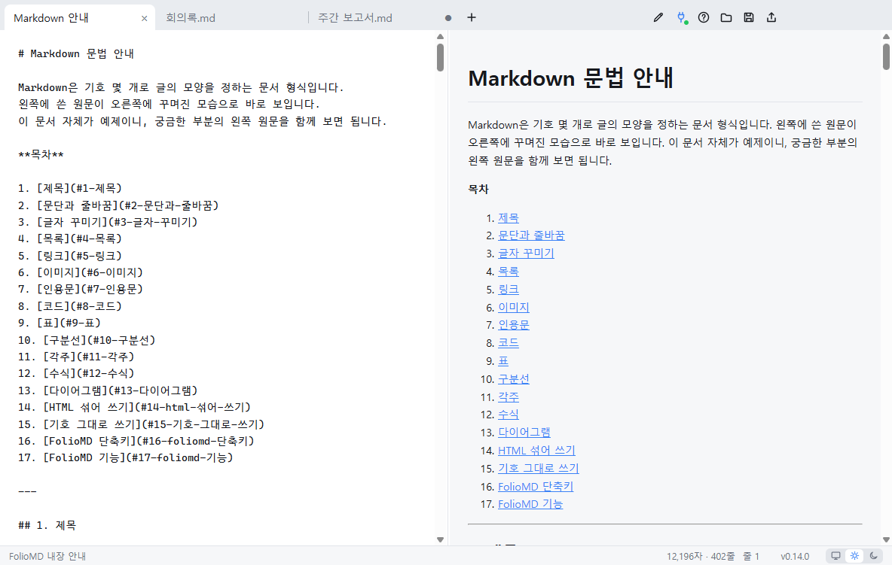

---

## 3. 문서 열고 저장하기

| 할 일 | 방법 |
|---|---|
| 새 문서 | **Ctrl+T** |
| 파일 열기 | **Ctrl+O**, 또는 파일을 창에 끌어다 놓기 |
| 저장 | **Ctrl+S** (.md 파일로 저장) |
| 다른 이름으로 저장 | **Ctrl+Shift+S** |
| 파일이 있는 폴더 열기 | 아래쪽 파일 경로 옆 **↗** |

- 저장하지 않은 탭에는 **●**가 붙습니다.
- 저장하지 않고 탭을 닫거나 FolioMD를 끄면 저장할지 먼저 묻습니다.
- 다른 프로그램이 열어 둔 파일을 고치면 탭이 저절로 새 내용으로 바뀝니다.

---

## 4. 탭 다루기

| 할 일 | 방법 |
|---|---|
| 탭 닫기 | **Ctrl+W**, 또는 탭을 마우스 휠로 클릭 |
| 다음 / 이전 탭 | **Ctrl+Tab** / **Ctrl+Shift+Tab** |
| 탭 이름 바꾸기 | **F2**, 또는 탭을 더블클릭 |
| 순서 바꾸기 | 탭을 옆으로 끌기 |
| 여러 탭 한꺼번에 정리 | 탭을 **오른쪽 클릭** |

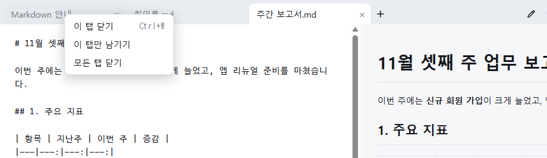

FolioMD를 껐다 켜면 열려 있던 파일이 같은 순서로 다시 열립니다. 저장하지 않은 새 문서는 다시 열리지 않으니 저장해 두세요.

---

## 5. 글 쓰기 (Markdown 기초)

| 이렇게 쓰면 | 이렇게 보입니다 |
|---|---|
| `# 제목` | 큰 제목 (`##`, `###`로 갈수록 작아짐) |
| `**굵게**` | **굵게** |
| `*기울임*` | *기울임* |
| `~~취소선~~` | ~~취소선~~ |
| `- 항목` | 글머리 목록 |
| `1. 항목` | 번호 목록 |
| `- [x] 할 일` | 체크 목록 |
| `[글자](https://주소)` | 링크 |
| `` | 그림 |
| `> 인용` | 인용문 |
| `` `코드` `` | `코드` |
| `---` | 구분선 |

표, 수식(`$E=mc^2$`), 순서도(mermaid), 코드 블록도 쓸 수 있습니다. 아래 화면의 오른쪽처럼 그려집니다. 쓰는 법은 **F1 안내서**에 예시와 함께 있습니다.

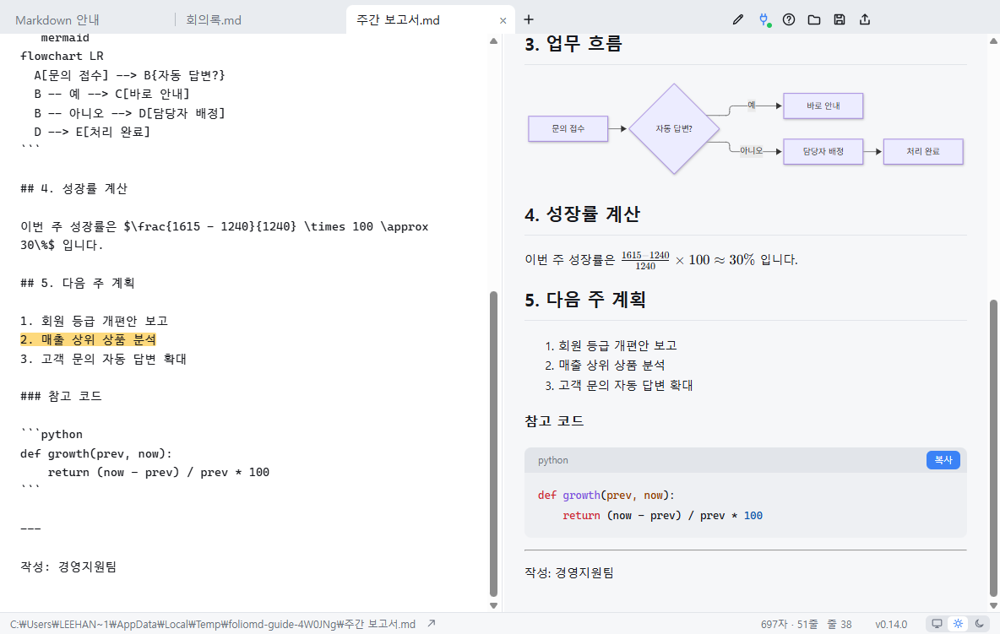

**붙여넣기도 편합니다**

- **엑셀 표**: 엑셀이나 구글 스프레드시트에서 셀을 복사해 붙여 넣으면 Markdown 표가 됩니다.
- **캡처 그림**: 캡처한 그림을 붙여 넣으면 md 파일 옆 `images` 폴더에 저장하고 링크를 넣습니다. 새 문서는 먼저 저장해야 합니다.

---

## 6. 찾기, 바꾸기, 줄 이동

### 찾기와 바꾸기

| 할 일 | 방법 |
|---|---|
| 찾기 | **Ctrl+F**, 다음은 **Enter** 또는 **F3**, 이전은 **Shift+Enter** |
| 바꾸기 | **Ctrl+H** |
| 모두 바꾸기 | **Ctrl+Alt+Enter** |
| 닫기 | **Esc** |

찾은 곳은 편집기에 칠해지고, 오른쪽에 "3/3"처럼 몇 번째인지 나옵니다. `Aa`는 대소문자 구분, `.*`는 정규식입니다.

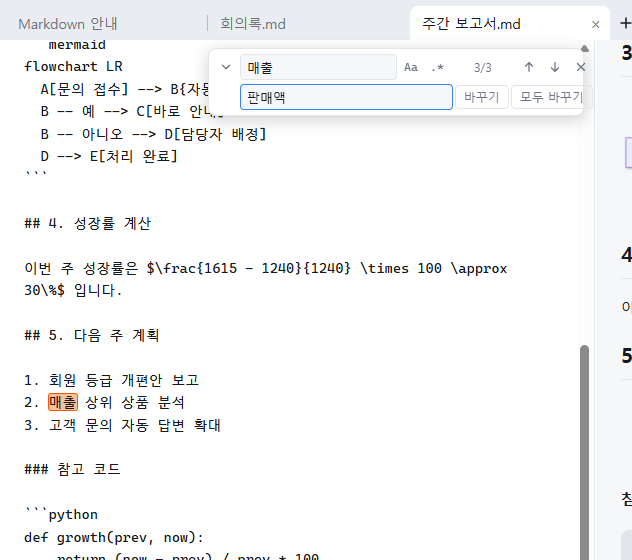

### 줄로 이동 (0.14.0부터)

1. **Ctrl+G**를 누르거나, 아래쪽의 `줄 1`을 클릭합니다.
2. 줄 번호를 치고 **Enter**를 누릅니다.

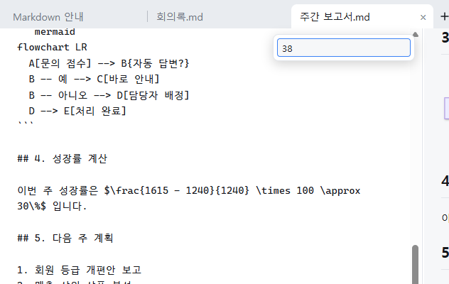

3. 그 줄로 가서 **잠깐 노랗게 깜빡**입니다. 커서도 그 줄에 있어서 바로 이어서 쓸 수 있습니다.


- 마지막 줄보다 큰 번호를 치면 마지막 줄로 갑니다.
- 아래쪽 `줄 38`처럼, 커서가 있는 줄 번호가 늘 나옵니다.

---

## 7. 미리보기에서 바로 고치기

### 더블클릭으로 그 자리에서 고치기

미리보기의 문단, 표, 목록을 **더블클릭**하면 그 자리에 원문이 열립니다.

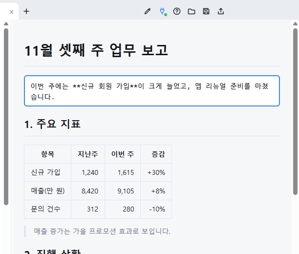

- **Ctrl+Enter**(또는 바깥 클릭)로 반영, **Esc**로 취소합니다.
- 잘못 고쳤으면 **Ctrl+Z**로 되돌립니다.

### Ctrl+클릭으로 원문 위치 찾기

미리보기에서 **Ctrl+클릭**하면 편집기가 그 글을 쓴 곳으로 가서 잠깐 노랗게 칠합니다. 긴 문서에서 "이 글이 원문 어디 있지?" 할 때 씁니다.

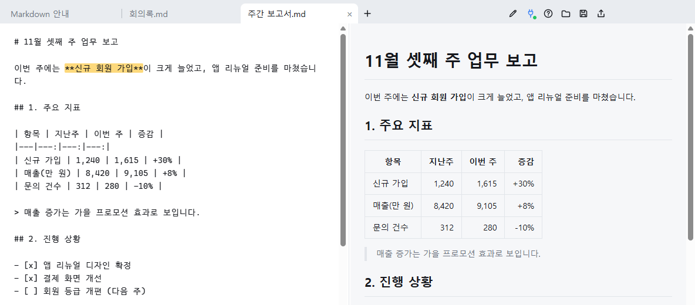

### 스크롤 따라가기

편집기를 움직이면 미리보기가, 미리보기를 움직이면 편집기가 같은 곳으로 따라갑니다.

---

## 8. 미리보기에 낙서하기

탭 줄 오른쪽의 **펜 아이콘**을 누르면 낙서 도구가 열립니다. 손으로 그린 느낌으로 그려집니다.

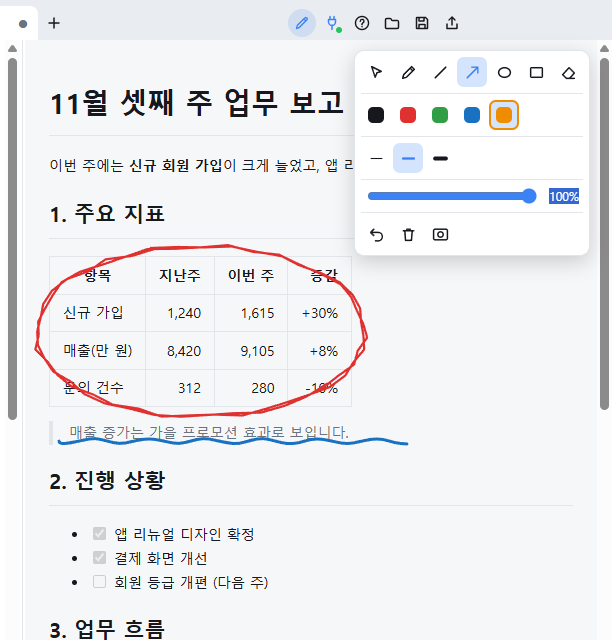

| 도구 | 숫자 키 | 하는 일 |
|---|---|---|
| 선택 | 1 | 낙서를 골라 옮기기, Delete로 지우기 |
| 펜 | 2 | 자유롭게 그리기 |
| 직선 | 3 | 선 긋기 |
| 화살표 | 4 | 화살표 |
| 동그라미 | 5 | Shift를 누르면 정원 |
| 네모 | 6 | Shift를 누르면 정사각형 |
| 지우개 | 7 | 문질러 지우기 |

- 색 5가지(검정, 빨강, 초록, 파랑, 주황), 굵기 3단계, 투명도(낮추면 형광펜처럼 씁니다).
- **Ctrl+Z** 되돌리기, 휴지통은 전부 지우기, 카메라는 낙서가 들어간 화면을 그림으로 저장합니다.
- 다 그렸으면 펜 아이콘을 다시 누르거나 **Esc**를 누릅니다.

> **낙서도 Ctrl+S로 저장해야 남습니다.** md 파일 내용은 바뀌지 않고, FolioMD가 따로 보관합니다.

---

## 9. PDF, HTML로 내보내기

탭 줄 맨 오른쪽의 **내보내기 아이콘**을 누릅니다.

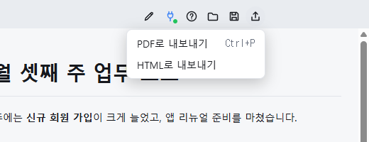

- **PDF로 내보내기 (Ctrl+P)**: A4 PDF로 저장합니다. 다크 모드여도 흰 종이로 나옵니다.
- **HTML로 내보내기**: 웹 페이지 파일 하나로 저장합니다. 그림도 파일 안에 들어가서 받은 사람도 그대로 봅니다.

낙서도 함께 들어갑니다.

---

## 10. 업데이트

FolioMD는 켤 때와 6시간마다 새 버전을 확인합니다.

1. 새 버전이 있으면 탭 줄 오른쪽 업데이트 아이콘에 **빨간 점**이 붙습니다. 마우스를 올리면 바뀐 점이 보입니다.
2. 아이콘을 누르면 설치합니다. **FolioMD는 꺼지지 않고** 하던 일을 계속할 수 있습니다.
3. 점이 **초록색**이 되면 설치가 끝난 것입니다. 다음에 켤 때 새 버전이 되고, 초록 점을 누르면 바로 다시 켜서 적용합니다.

오른쪽 아래 **버전 번호**를 누르면 정보 카드에서 지금 버전과 업데이트 상태를 볼 수 있습니다.

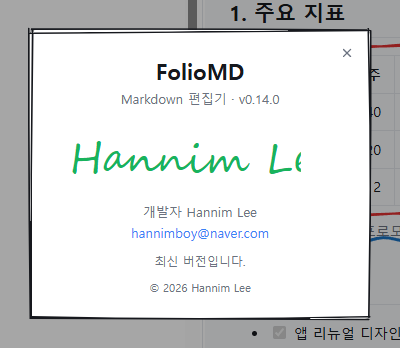

---

## 11. Claude Code와 함께 쓰기

Claude Code(터미널에서 쓰는 Claude)를 쓰고 있다면 연결할 수 있습니다. 쓰지 않으면 건너뛰세요.

1. 탭 줄 오른쪽의 **플러그 버튼**을 누릅니다. 파란색에 초록 점이 붙으면 연결된 것입니다.
2. 열려 있던 Claude Code를 껐다가 다시 켭니다.

연결하면 Claude가 쓴 md 파일이 FolioMD에 저절로 열리고, 이렇게 말할 수 있습니다.

| 이렇게 말하면 | 일어나는 일 |
|---|---|
| "폴리오에 열린 문서 요약해 줘" | 지금 보고 있는 문서를 읽고 요약합니다 |
| "문서에서 환불 규정 찾아 줘" | 그곳으로 스크롤하고 강조합니다 |
| "중요한 곳에 빨간 동그라미 쳐 줘" | 미리보기에 손그림으로 표시합니다 |
| "내가 고른 부분 존댓말로 바꿔 줘" | 선택한 부분을 고칩니다 |
| "빨간펜 반영해 줘" | 내가 낙서로 표시한 곳과 손글씨 메모를 읽고 글을 고칩니다 |
| "회의록 초안을 새 탭에 써 줘" | 새 탭에 글을 씁니다 |
| "순서도 제대로 그려졌는지 봐 줘" | 화면을 찍어 직접 확인합니다 |

- Claude가 고친 내용은 **Ctrl+Z**로 되돌릴 수 있습니다.
- Claude는 파일을 저장하지 않습니다. 남기려면 직접 **Ctrl+S**를 누르세요.
- 연결을 끊으려면 플러그 버튼을 다시 누릅니다.

---

## 12. 자주 묻는 질문

**Q. 업데이트 아이콘이 안 보여요.**
새 버전이 없거나 인터넷에 연결되지 않은 것입니다. 다른 기능은 그대로 됩니다. 새 버전이 막 나온 직후에는 몇 분 뒤에 뜹니다.

**Q. 낙서가 사라졌어요.**
낙서를 그린 뒤 저장(Ctrl+S)하지 않고 닫으면 마지막으로 저장한 낙서로 돌아갑니다.

**Q. 붙여 넣은 그림이 안 들어가요.**
새 문서는 먼저 Ctrl+S로 저장해야 그림을 둘 폴더가 정해집니다.

**Q. 껐다 켰더니 탭이 없어졌어요.**
저장하지 않은 새 문서는 다시 열리지 않습니다. 파일로 저장한 탭만 돌아옵니다.

**Q. 화면이 너무 밝아요(어두워요).**
오른쪽 아래 아이콘에서 라이트, 다크, 시스템(Windows 설정 따라감)을 고릅니다.

**Q. 지우고 싶어요.**
Windows **설정 → 앱 → 설치된 앱**에서 FolioMD를 찾아 **제거**합니다. Claude Code 연결도 함께 해제됩니다.
